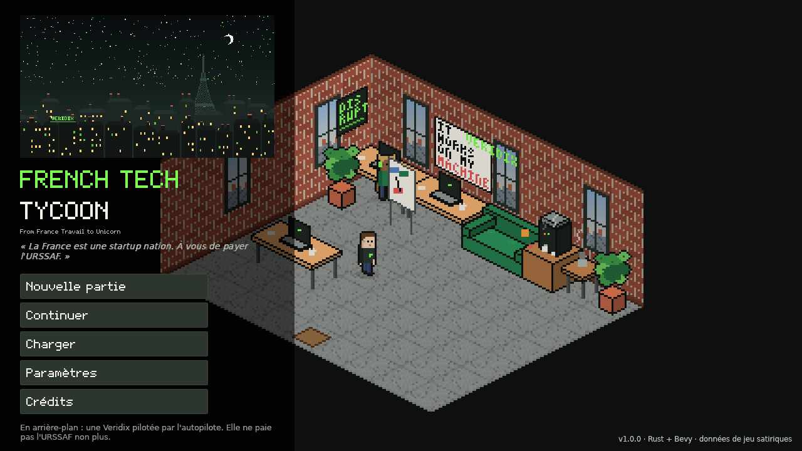
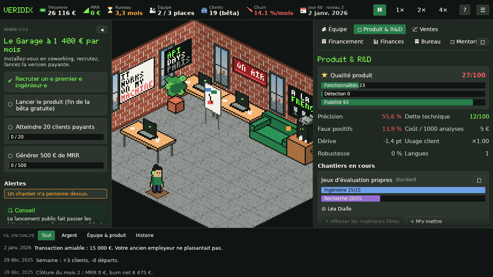
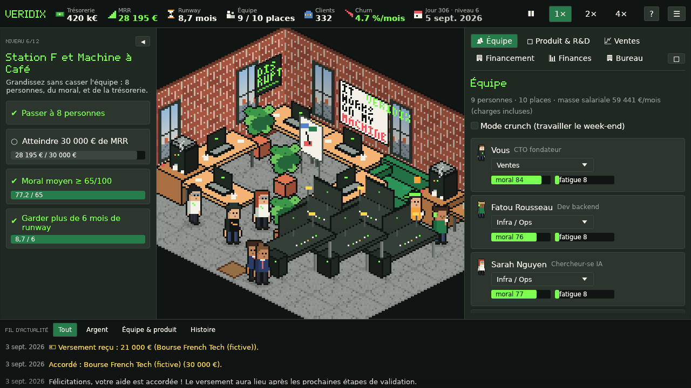
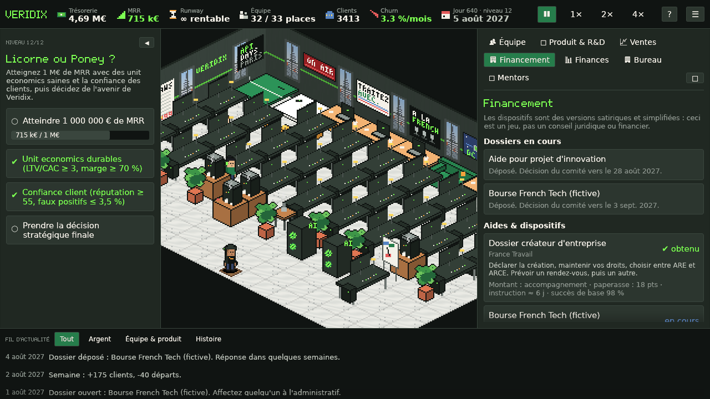
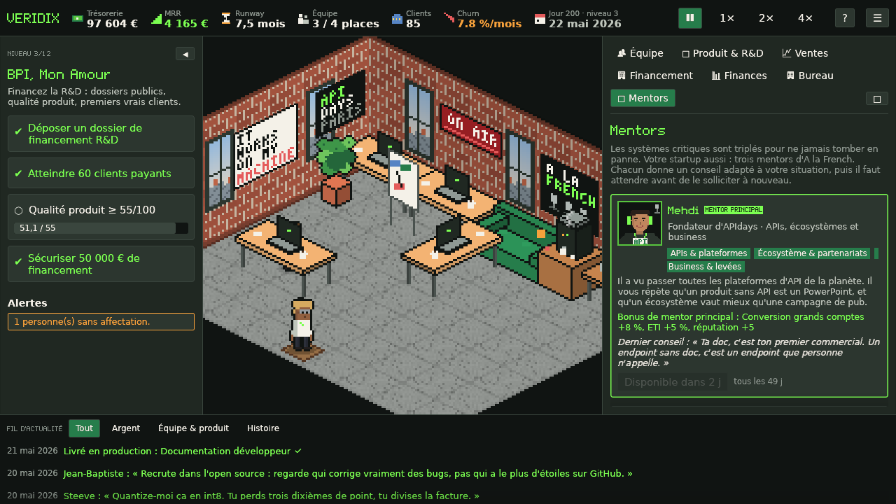

# A la French — le jeu

*De France Travail à la licorne*

> « La France est une startup nation. À vous de payer l'URSSAF. »

**▶ Jouer en ligne : https://mehdim.github.io/french-tech-le-jeu/**

Un jeu de gestion satirique sur **VERIDIX**, une startup parisienne d'IA qui
prétend détecter les contenus générés par IA (son premier modèle obtient 53 %
sur son propre benchmark). Emmenez-la d'un appartement à deux laptops et d'un
rendez-vous France Travail jusqu'à Davos. En chemin : dossiers Bpifrance,
business angels de l'ère du Minitel, une série A pitchée sur PowerPoint,
achats publics, une facture GPU qui explose, une filiale à San Francisco, des
fabricants de modèles chinois, des chefs d'État à convaincre, des datacenters
trop gourmands, et un choix final : **Série C, introduction en Bourse, rachat
par NVIDIA, entreprise rentable ou communs open source**.

Vous choisissez votre héros (fondateur ou fondatrice) et son nom, et un
tutoriel en bulles vous guide pendant les deux premiers niveaux. Avec trois
mentors venus tout droit du podcast **A la French** : Mehdi, Steeve et
Jean-Baptiste. Écrit en Rust avec Bevy, compilé en WebAssembly,
joué dans le navigateur.



| Niveau 2 — le garage | Niveau 6 — Station F | Niveau 12 — siège européen |
|---|---|---|
|  |  |  |



## Jouer

Le plus simple : **https://mehdim.github.io/french-tech-le-jeu/**

La version navigateur est un dossier de fichiers statiques (`dist/`). Pour la
lancer chez vous, servez-la avec n'importe quel serveur web statique ; elle ne
fonctionne pas en `file://`, car le wasm et les ressources sont chargés en HTTP :

```bash
cd dist && python3 -m http.server 8080
# ouvrir http://localhost:8080
```

Les joueurs n'ont besoin ni de Rust ni d'aucun plugin : seulement d'un
navigateur avec WebAssembly et WebGPU ou WebGL2.

### Navigateurs pris en charge

| Navigateur | Rendu | État |
|---|---|---|
| Chrome / Edge 113+ (desktop) | WebGPU, repli automatique sur WebGL2 | Rendu WebGL2 testé dans Chromium sans affichage (voir plus bas) |
| Firefox 115+ | WebGL2 (WebGPU à partir de la 141 sous Windows) | Devrait fonctionner ; pas de test automatique |
| Safari 17+ (macOS) | WebGL2 (WebGPU dans Safari 26) | Devrait fonctionner ; pas de test automatique |
| Navigateurs mobiles | WebGL2 | Jouable au toucher, mais l'interface vise ≥ 1280×720 |

Le chargeur (`web/loader.js`) demande un adaptateur WebGPU au navigateur. S'il
en existe un, il charge le build WebGPU, sinon le build WebGL2. Si le build
WebGPU ne démarre pas (périphérique perdu, Bevy qui s'arrête sur une erreur de
rendu, ou pas prêt en 25 s), le chargeur le mémorise dans `localStorage` et
recharge la page en WebGL2. Si ni WebAssembly ni l'une de ces deux API ne sont
disponibles, il affiche un message de compatibilité qui explique ce qui
manque, au lieu d'un canvas noir. Une panne GPU après le démarrage affiche un
écran « Recharger » plutôt qu'un canvas figé. On peut forcer le rendu avec
`?renderer=webgl2` ou `?renderer=webgpu` ; en WebGPU forcé, les erreurs sont
affichées au lieu de déclencher le repli.

**Ce qui a été vérifié, et ce qui ne l'a pas été.** Dans Chromium sans affichage
(SwiftShader, sans GPU physique) :

- Le build WebGL2 se joue : nouvelle partie, événements, sauvegarde auto,
  rechargement, reprise.
- L'écran de compatibilité apparaît quand WebGL et WebGPU sont désactivés.
- Le build WebGPU obtient un adaptateur, mais le WebGPU logiciel expérimental
  de Chromium signale ensuite un périphérique perdu. C'est ce qui a permis de
  tester le repli automatique, qui fonctionne (WebGL2, jouable en ~5 s).

Le build WebGPU n'a **pas** été vérifié sur un vrai GPU. Sur un ordinateur où
WebGPU fonctionne, il devrait tourner ; sinon, les joueurs passent
silencieusement en WebGL2.

### Commandes

| Action | Souris / tactile | Clavier |
|---|---|---|
| Déplacer la vue | glisser (n'importe quel bouton), glisser à un doigt | ZQSD (WASD en QWERTY) / flèches |
| Zoomer | molette, pincer | `+` / `-` |
| Sélectionner un salarié ou un meuble | clic | |
| Pause / reprise | ⏸ dans la barre du haut | `Espace` |
| Vitesse 1× / 2× / 4× | barre du haut | `1` `2` `3`/`4` |
| Panneaux : Équipe, Produit & R&D, Ventes, Financement, Finances, Bureau, Mentors | onglets du panneau de droite | `E` `P` `V` `F` `C` `B` `M` |
| Pivoter un meuble pendant le placement | | `R` |
| Poser plusieurs exemplaires | | maintenir `Maj` |
| Annuler le placement | clic droit | `Échap` |
| Réplique suivante / lancer le niveau | « Suivant », « C'est parti ! » | `Entrée` |
| Répondre à un événement | clic sur un choix | `1`–`4` |
| Menu pause (sauvegarde / chargement / paramètres) | ☰ | `Échap` |

Les touches sont lues par position physique : sur un clavier AZERTY, le
déplacement se fait donc avec ZQSD.

## Contenu du jeu

- **Votre héros ou votre héroïne** : à la création de la partie, choisissez
  fondateur ou fondatrice (sprite, portrait et combat assortis) et un nom ;
  les dialogues s'accordent (« la fondatrice », « {nom} sonne la cloche »…).
- **Un tutoriel guidé** sur les niveaux 1 et 2 (facultatif, désactivable à
  tout moment) : 15 bulles qui désignent l'élément à utiliser (onglet,
  chantier, dossier France Travail, menu d'affectation, recrutement…) et
  avancent dès que l'action est faite.
- **Une campagne de 16 niveaux, plus un niveau bonus selon la fin choisie**, chacun avec une introduction, 2 à 5
  objectifs mesurables, un événement majeur unique, un déblocage et une
  conclusion humoristique. De « France Travail Simulator » à « Sobriété ou
  Surchauffe ». Les quatre derniers chapitres :
  - **13 — Le Rêve Américain** : ouvrir une filiale à San Francisco (900 k€,
    puis 90 k€/mois), recruter sur place, passer SOC 2… pendant que deux
    anciens salariés lancent « Veridupe », un concurrent financé à 20 M$ ;
  - **14 — La Grande Muraille des Tokens** : apprendre le mandarin, recruter
    des commerciaux chinois, vendre un SDK de watermarking aux fabricants de
    modèles chinois, et ne pas se faire espionner (clé USB en forme de panda) ;
  - **15 — Davos, Mon Amour** : le fondateur part au Forum, reçoit huit chefs
    d'État et doit négocier politiques industrielles et investissements pour
    éviter les lois taillées sur mesure contre Veridix. Il faut **10 accords
    d'État** (Davos, visites d'État répétables, dîners officiels) ; puis
    préparer la suite : Série C, IPO ou rendez-vous avec NVIDIA ;
  - **16 — Sobriété ou Surchauffe** : Veridix a ses propres datacenters et
    consomme trop d'électricité. Il faut diviser l'énergie par analyse par
    deux, récupérer la chaleur, signer de l'électricité bas carbone, garder ses
    marges, et **tenir 5 M€ de MRR pendant 6 mois (ou toucher 100 M€ d'ARR
    un jour)** avant de boucler la campagne.
  - **17 — La Bourse ou la Vie** (si vous choisissez l'IPO) : VRDX est cotée
    et les médias se déchaînent. Six scandales scénarisés (#Veridix1789, la
    fausse empreinte carbone, les copies du bac, la thèse de la fondatrice ou
    du fondateur, le « yacht » qui était un pédalo, la rumeur selon laquelle
    vous seriez une IA), un **cours de bourse** à garder au-dessus du prix
    d'introduction (roadshows, résultats trimestriels, rachats d'actions),
    une réputation à tenir, et le rapport d'un vendeur à découvert ;
  - **18 — Le Badge Vert** (si vous choisissez le rachat par NVIDIA) : votre
    nouveau manager, Kyle Throughput (personnage fictif), exige de faire
    vendre 250 000 GPU grâce à Veridix. Bundles « Veridix Inside », détecteur
    XXL, analyse vidéo en 8K, réécriture CUDA, fin de l'offre gratuite pour
    les écoles… et deux trahisons obligatoires : saborder la sobriété et
    fermer les modèles. Jean-Baptiste appelle. Le cône est triste.
- **Des événements satiriques sur trois écosystèmes** (niveaux 13 à 16) :
  Europe (annexe XLVII du règlement sur l'IA, bannière de consentement à
  14 cases, taxe numérique version 7, droit à un humain…), États-Unis
  (droits de douane sur les algorithmes, cinquante lois sur l'IA, loterie des
  visas, pub du Super Bowl…) et Chine (registre des algorithmes, guerre des
  prix des tokens, clone sur la messagerie, contrôles à l'export des puces…).
  Chaque décision politique change les lois, les prix ou les coûts.
- **Des offres de rachat hostiles** aux niveaux 14 et 15 : Google, Microsoft,
  Amazon, Meta ou NVIDIA veulent racheter Veridix. Accepter met fin à la
  partie ; refuser lance une défense de 1 000 points de « Levée de fonds »
  (fondateur ou CFO) en 120 jours, puis un **face-à-face au tour par tour**
  contre le ou la responsable des acquisitions de l'entreprise (personnages
  fictifs en pixel art, dialogues épiques avant et pendant le combat, jauge de
  visée, appel aux mentors d'A la French, pilule empoisonnée). Défaite : le
  rachat est signé et la partie s'arrête.
- **Des projets somptuaires** pour les niveaux 14 à 16, jusqu'à 20 000
  points d'ingénierie, 10 000 points de recherche et 200 M€ : détecteur
  multimodal, supercalculateur « Jules-Verne », Veridix-1 (2 000 milliards de
  paramètres), datacenter en orbite, Veridix OS, datacenter sous-marin au
  large de Brest, puces neuromorphiques, contrat de fusion nucléaire, et
  « l'Auditeur », une IA qui certifie toutes les autres.
- **Un effectif minimum à partir du niveau 10** : 20 salariés dont
  4 ingénieur·es à plein temps (développement ou infrastructure). En dessous,
  la dette technique, la dérive et la fatigue s'emballent. Les chantiers de fin
  de partie (SOC 2, région cloud américaine, copilote agentique, modèle de
  fondation maison, préparation à l'IPO…) coûtent des centaines de milliers
  d'euros et des mois d'ingénierie. Au niveau 11, Veridix s'installe d'office
  au campus Station F si ce n'est pas déjà fait.
- **5 fins principales illustrées, chacune avec son animation et son
  mini-jeu de 30 secondes** avant l'épilogue (plus 5 fins de rachat) :
  - licorne mondiale (Série C) : la licorne vole et attrape les sacs de la
    Série C en évitant les nuages de « down round » ;
  - introduction en Bourse : la cloche sonne, puis il faut tenir le cours de
    VRDX en démentant les rumeurs et en saisissant les bonnes nouvelles ;
  - rachat par NVIDIA : pluie de GPU à attraper dans la baie Veridix, sans
    les clauses d'earn-out ;
  - entreprise rentable : les pièces s'empilent, puis il faut couper les
    dépenses inutiles (offsite à Ibiza, kombucha bio…) sans couper les clients ;
  - communs : l'arbre de commits pousse, le Président de la République vous
    remet l'ordre national du Mérite à l'Élysée… et le lendemain, retour à
    France Travail, ticket en main ; puis « merge ou close » sur une pluie de
    pull requests.
- **Trois mentors d'A la French**, dont les portraits reprennent
  l'illustration de l'émission. Au début de la campagne, vous choisissez
  un mentor principal, dont le bonus est permanent :
  - **Mehdi** (APIs, écosystème, business) : conversion grands comptes et ETI, réputation ;
  - **Steeve** (infra, inférence, performance) : coût d'inférence et résilience ;
  - **Jean-Baptiste** (open source, souveraineté, recrutement) : réputation, moral, rétention.

  Pendant la partie, le panneau Mentors (`M`) permet de demander conseil à
  chacun : il donne le premier de ses conseils qui correspond à votre situation
  (pas d'API, dette technique, marge qui part en GPU, équipe épuisée…), avec un
  effet réel, puis il faut attendre 7 semaines (mentor principal) ou 14 avant
  de le solliciter à nouveau.
- **Des clins d'œil au podcast** : événements tirés des épisodes (« Ils ont
  effacé la prod ! », vibecoding, datacenters dans l'espace, les 7 business
  models de l'open source, la soirée A la French, « pas une colonie
  numérique », robots humanoïdes), affiches au mur (ON AIR, « Traitez avec. »,
  « Le monde avec l'accent », systèmes critiques triplés…), un studio podcast à
  trois micros, des cônes de chantier et un échiquier dans la boutique du
  bureau. Le mentor principal laisse aussi un souvenir au mur.
- **Une simulation quotidienne déterministe** (1 tick = 1 jour, soit 3,2 s
  à la vitesse 1× ; mois comptables de 28 jours) : leads → conversion → abonnements → churn par segment de
  clientèle, MRR/ARR, COGS (inférence + hébergement), marge brute, burn,
  runway, CAC, LTV, ARPA, valorisation et table de capitalisation.
- **Une R&D en IA qui ne « résout » jamais la détection** : 99 chantiers
  produit, recherche, entreprise et pivot IA native, avec dépendances, points
  d'ingénierie et de recherche, coût, risque de dette technique et approche
  « vite fait » ou « propre ». La dérive des données et les nouveaux modèles
  de fondation érodent sans cesse la précision et le taux de faux positifs.
- **Des salariés qui sont de vraies entités** : plus de 12 profils
  (Polytechnicien, dev de 42, évangéliste Rust, ex-GAFAM, consultant d'ESN,
  docteur·e en IA, growth hacker, PM fan de Jira…) avec compétences, moral,
  fatigue, loyauté et traits de caractère. Recrutement via 11 canaux
  (LinkedIn, France Travail, grandes écoles, 42, open source, cabinets,
  cooptation, ESN, et sur place à San Francisco et à Shanghai, avec des
  salaires… locaux). Licencier coûte des indemnités et du moral.
- **L'écosystème français comme mécanique de jeu** : accompagnement France
  Travail, dispositifs Bpifrance satiriques (subventions, aide à
  l'innovation, prêts, deeptech, export) avec dossiers, paperasse, délais et
  versements échelonnés ; allègements façon JEI/CIR ; quatre business angels
  récurrents (Jean-Michel Exit 2001, Patrick Blockchain, Bernard EBITDA,
  Sophie Term Sheet) ; des VC du seed à la série C, avec dilution.
- **149 événements pilotés par les données** (100 aléatoires, 49 scénarisés), avec conditions,
  pondérations, délais de carence et choix aux effets immédiats et différés
  (l'incident Kubernetes, le dilemme du modèle open-weight chinois,
  l'influenceur LinkedIn, la clé d'API publiée par le stagiaire…).
- **Un bureau isométrique en pixel art** qui évolue sur 6 niveaux, de
  l'appartement au siège européen. Les salariés animés marchent, s'assoient,
  tapent, prennent un café, se réunissent, paniquent et font des burn-out. Le
  mobilier se place sur une grille avec aperçu, vérification, rotation,
  déplacement et rangement ; chaque meuble influe sur le moral, la capacité,
  l'efficacité ou l'infrastructure.
- **Sauvegardes** : sauvegarde auto chaque mois de jeu et à chaque changement
  de niveau, plus 3 emplacements manuels. Les sauvegardes portent une version
  de schéma et une somme de contrôle, les sauvegardes corrompues sont
  détectées, et la progression peut être réinitialisée.
- **Musique** : le thème du générique d'*À la French* réarrangé en 16 bits
  (lead synthé avec écho, basse glissée, nappes, arpèges, batterie), en boucle
  au menu. Au bureau, une playlist enchaîne ce thème, « La Marseillaise » en
  marche de console 8-bit, et une gigue celtique originale en 16 bits (violon,
  flûte irlandaise, bodhrán, harpe et bourdon). Plus des effets sonores (caisse enregistreuse, alertes, financement, frappe au
  clavier, machine à café, jingle de faillite). Réglages de volume et mode
  basse consommation à 30 FPS.

Quelques répliques restent volontairement en anglais : le pitch d'un VC
américain, les recrues de San Francisco et les répliques de NVIDIA.

## Compiler depuis les sources

### Prérequis

- Rust **1.95+** (vérifié avec 1.97.0) ; `rust-toolchain.toml` sélectionne la version stable
- Pour la version navigateur :
  - `rustup target add wasm32-unknown-unknown`
  - `cargo install wasm-bindgen-cli --version 0.2.129` (doit correspondre à `wasm-bindgen` dans `Cargo.lock`)
  - optionnel : `wasm-opt` de [binaryen](https://github.com/WebAssembly/binaryen/releases) dans le `PATH` (binaire plus petit)
- Sous Linux, `cargo test --workspace` et le client natif compilent aussi le
  client Bevy, dont le moteur audio est lié à ALSA :
  `sudo apt install pkg-config libasound2-dev`.
  (X11, Wayland et xkbcommon sont chargés à l'exécution ; une session de bureau les fournit.)

### Tests

```bash
cargo test --workspace
```

Les tests de la simulation sont dans les crates en Rust pur (`game-core`,
`game-content`, `platform`) et n'ont pas besoin de GPU. `cargo test` sans
`--workspace` ne lance que ces crates et ne demande aucune bibliothèque
système. La suite comprend un autopilote scripté qui joue **toute la campagne
de 16 niveaux jusqu'à la victoire** sur plusieurs graines (et les niveaux
bonus 17 et 18 en forçant l'IPO ou le rachat par NVIDIA), ainsi que des tests
de déterminisme, d'aller-retour des sauvegardes, de rejet des sauvegardes
corrompues, de faillite par recrutement imprudent, de churn qui punit la
croissance sans rétention, de dette technique, de règles de placement du
mobilier, de calcul de dilution et de paperasse des subventions.

```bash
cargo run -p game-content --example balance -- 42 quiet   # rapport d'équilibrage de la campagne
cargo run -p game-content --example balance -- 42 quiet ipo   # … en choisissant l'IPO (niveau 17)
```

### Version navigateur

```bash
tools/build-web.sh                      # → dist/ (builds WebGPU + WebGL2)
RENDERERS=webgl2 tools/build-web.sh     # un seul rendu, deux fois plus rapide
cd dist && python3 -m http.server 8080
```

Bevy choisit WebGPU ou WebGL2 à la compilation : le script compile donc le
client deux fois (`--features webgpu` et `--features webgl2`) et passe chaque
résultat dans `wasm-bindgen --target web`. Il lance ensuite `wasm-opt -Oz`
s'il est disponible, puis copie la page HTML de `web/` et les ressources dans
`dist/`. Le profil `wasm-release`, orienté taille, est défini dans
`Cargo.toml`.

Si la cible `wasm32-unknown-unknown` ne peut pas être installée (réseau
restreint) mais que le composant `rust-src` est présent, le script compile la
bibliothèque standard depuis les sources avec `-Zbuild-std`. C'est ainsi que
le build a été produit dans le bac à sable de développement.

### Test de fumée dans le navigateur

```bash
pip install playwright && python -m playwright install chromium
python tools/smoke_test.py dist --shots smoke-shots
```

Le test ouvre `dist/` dans Chromium sans affichage, comme un visiteur (le
chargeur choisit le rendu ; `--renderer webgl2|webgpu` en force un). Il attend
le chargement du jeu, lance une nouvelle campagne avec `Entrée`, fait tourner
le temps en 4×, répond aux événements avec les touches numériques, et vérifie
que la sauvegarde mensuelle auto arrive dans `localStorage`. Il recharge ensuite
la page, reprend la partie, et échoue à la moindre exception non interceptée
ou panique Rust. Les touches sont tenues 120 ms, comme par une personne : en
rendu logiciel, la page peut n'afficher que quelques images par seconde, et un
appui instantané peut tomber entre deux images.

### Version native (desktop)

```bash
cargo run -p game-client --release
```

Le client natif sert au développement. Il a aussi des points d'automatisation
pour les captures d'écran et la CI (`FTT_START=new|auto:<jours>`, `FTT_SHOTS`,
`FTT_EXIT`, `FTT_TAB`, `FTT_SPEED` ; voir `crates/game-client/src/dev.rs`).

## Déployer (GitHub Pages)

C'est ainsi que le jeu est publié. Dans les **Settings → Pages** du dépôt, la
source est **GitHub Actions** ; `.github/workflows/pages.yml` compile le jeu à
chaque push sur `main` et le publie sur `https://<propriétaire>.github.io/<dépôt>/`.
Tous les chemins du build sont relatifs : le jeu fonctionne sous ce sous-chemin.

## Déployer (Cloudflare Pages)

`dist/` est un site statique. `web/_headers` (copié dans `dist/`) définit le
type `application/wasm` et la mise en cache.

```bash
npx wrangler pages deploy dist --project-name french-tech-tycoon
```

Ou connectez le dépôt dans le tableau de bord Cloudflare avec :

- Commande de build : `tools/build-web.sh` (l'image de build doit avoir Rust ; la GitHub Action ci-dessous est plus simple)
- Dossier de sortie : `dist`

`.github/workflows/ci.yml` lance les tests et clippy, compile `dist/`, lance le
test de fumée dans le navigateur, publie `dist/` comme artefact, et déploie sur
Cloudflare Pages depuis `main` si les secrets `CLOUDFLARE_API_TOKEN` et
`CLOUDFLARE_ACCOUNT_ID` sont définis.

Chaque fichier wasm pèse ~21 Mo (~7 Mo compressé), sous la limite de 25 Mio
par fichier de Cloudflare Pages. Un visiteur ne télécharge qu'un des deux
builds. Pour un hébergeur avec une limite plus basse,
`tools/split-wasm.sh dist 12` découpe chaque module en morceaux de ≤ 12 Mio
plus un `parts.json`, que le chargeur télécharge et réassemble. Le profil
`wasm-release` utilise `opt-level = "z"` avec un LTO léger (thin), suivi de
`wasm-opt -Oz`. Le LTO complet (fat) réduit encore la taille mais demande plus
de 7 Go de RAM à l'édition des liens.

## Architecture

```
crates/
  game-core/      Simulation déterministe. Ni Bevy, ni API navigateur.
                  GameState est l'unique état de référence ; Command est le
                  seul moyen de le modifier (l'interface et l'autopilote
                  utilisent les mêmes commandes). Économie, clients, salariés,
                  produit/recherche, financement, événements, objectifs,
                  grille du bureau, format de sauvegarde.
  game-content/   Convertit assets/data/*.ron (intégrés à la compilation) en
                  Content, vérifie les références croisées, met en forme les
                  messages de la simulation en français, et contient
                  l'autopilote.
  platform/       Adaptateurs : Storage (localStorage sur le web, fichiers sur
                  desktop, mémoire dans les tests) et horloge. Un portage
                  mobile ajoute une autre implémentation de Storage.
  game-client/    Présentation Bevy 0.19 : rendu isométrique, machine à états
                  d'animation, caméra, entrées, panneaux de gestion egui,
                  audio, sauvegardes, menus, AppState explicite (MainMenu,
                  Playing, Paused, MissionComplete, GameOver, Victory).
assets/
  data/*.ron      niveaux, événements, chantiers, salariés, financement,
                  marché, bureau, équilibrage. Tous les réglages sont ici,
                  pas dans le code.
  sprites, tilesets, characters, ui, backgrounds, fonts, audio
tools/
  art/            Générateurs Python de chaque atlas de sprites, portrait,
                  illustration de fin et de la police pixel (sorties versionnées).
  audio/          synthétiseur numpy pour la musique et les effets (→ Ogg Vorbis).
  build-web.sh    build navigateur
  split-wasm.sh   optionnel : découpe le wasm pour les hébergeurs qui limitent la taille par fichier
  smoke_test.py   test Playwright dans le navigateur
web/              index.html, style.css, loader.js, _headers, favicon
```

**Simulation, présentation et contenu sont séparés.** Les revenus ne sont
jamais calculés dans le code d'interface, les textes ne côtoient jamais les
formules économiques, et objectifs et événements sont des données avec des
conditions et des effets typés. La simulation avance par ticks fixes d'un jour
entier. Le client convertit temps réel × vitesse en ticks avec un accumulateur,
pour que la fréquence d'affichage ne change jamais les résultats. Les
sauvegardes sérialisent le `GameState` de référence, y compris l'état du
générateur aléatoire ChaCha, jamais les entités de rendu : une partie chargée
continue exactement comme elle l'aurait fait.

**Sauvegardes sur le web** : elles utilisent `localStorage`, synchrone et
disponible dans tous les navigateurs ; une sauvegarde de campagne complète
(~40–80 Ko) est très loin du quota par origine. Les erreurs (navigation privée,
quota) remontent dans l'interface. IndexedDB ne serait utile que pour des
sauvegardes bien plus grosses ; le trait `Storage` permet de l'ajouter.

**Pourquoi egui pour les panneaux** : l'interface de gestion est dense en
données (tableaux, barres de progression, infobulles, listes déroulantes, fils
défilants), ce qu'egui gère bien avec peu de code. Le bureau lui-même est
dessiné avec des sprites Bevy issus d'atlas de textures, triés par profondeur
isométrique.

## Graphismes et audio

Tous les éléments visuels et sonores sont originaux et générés par les scripts
de `tools/`. Aucun graphisme, musique ou son tiers n'est inclus : le thème
d'*À la French* (fourni par l'équipe de la chaîne) et les airs
traditionnels (domaine public) sont réarrangés et synthétisés par
`tools/audio/gen_audio.py`. Les portraits des trois mentors sont recadrés
et pixélisés à partir de l'illustration de l'émission fournie par l'équipe
d'*À la French* (`tools/art/refs/alafrench_hosts.png`). La police du
texte de l'interface est un sous-ensemble de DejaVu Sans (licence Bitstream
Vera / DejaVu) ; la police pixel *VeridixPixel* est originale.

La palette suit l'identité noir / vert électrique / blanc cassé d'« À la
French » : quasi-noir `#101412`, graphite `#202822`, vert électrique `#7CFF52`,
vert profond `#267D4B`, blanc cassé `#F4F1E8`, gris clair `#BEC5BB`. L'orange
`#F6A23C` et le rouge `#E45B5B` sont réservés au danger financier, au burn-out
et aux crises.

*Note :* le cahier des charges mentionne une vidéo de référence locale
(`Le passage du SaaS à l'IA native [ATc5dtUdosY].webm`). Elle n'était pas
présente dans l'environnement de développement : la direction artistique suit
donc la palette et les références écrites, et non des images de cette vidéo.

## Avertissement

Ceci est une satire. France Travail, Bpifrance, Station F et les autres
institutions y apparaissent sous forme de mécaniques de jeu simplifiées et
romancées. Rien ici n'est un conseil juridique, fiscal ou de financement, et
toutes les personnes, tous les investisseurs et toutes les entreprises du jeu
sont fictifs, à l'exception des trois animateurs d'A la French, qui ont donné
leur accord pour apparaître comme mentors. Leurs portraits sont des pixel arts
stylisés (casque de podcast, accessoire lié à leur domaine).

## Licence

MIT OR Apache-2.0.
